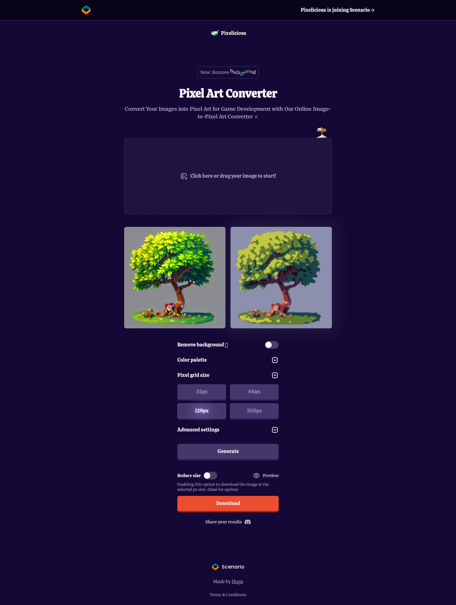

# Pixelicious — reconstruction

A locally runnable reconstruction of **Pixelicious**, the online "Image to Pixel Art
Converter" that lived at `https://www.pixelicious.xyz/`, rebuilt from its own archived
artifacts.

The reference snapshot is **`2024-10-14 16:56:40 UTC`**
(`https://web.archive.org/web/20241014165640/https://www.pixelicious.xyz/`).

This is a reconstruction, not a redesign: the layout, colours, typography, copy, assets and
interaction model come from the recovered sources, and everything the original did through a
backend that no longer exists has been rebuilt locally and labelled as such.



---

## Quick start

```bash
npm install
npm run dev          # http://localhost:5173
```

Then click the dashed box (or drag an image onto it) and pick a PNG, JPEG or WebP. The tool
converts immediately with the original's default 16-colour palette, and the controls below
the previews let you change the pixel grid size, swap the palette, toggle denoising and
re-generate. **Download** exports the pixel art as a PNG named `<yourfile>-pixelicious.png`.

Everything runs in your browser. No image is ever uploaded anywhere.

### Scripts

| Command | Purpose |
| --- | --- |
| `npm run dev` | Vite dev server (binds `0.0.0.0:5173`) |
| `npm run build` | Static production build into `build/` |
| `npm run preview` | Serve the production build |
| `npm run check` | `svelte-check` type/template check |
| `npm test` | Unit tests for the conversion core and upload validation |
| `npm run verify:pipeline` | Runs the real pipeline over the original site's own sample PNG and writes results to `recovery/verification/` |
| `npm run verify:screenshots` | Captures the reconstruction and the live Wayback snapshot for visual comparison |
| `npm run verify:browser` | Playwright end-to-end test of the running app (needs setup — see below) |

To serve the dev server under a forwarded hostname, pass it in the environment so no
hostname is baked into the repo:

```bash
PREVIEW_HOST=my-preview-host.example npm run dev -- --port 3000
```

---

## What the app does

**Upload.** Click the dashed `max-w-[656px]` zone or drop a file on it. Only PNG, WebP and
JPEG are accepted — exactly the three types the original checked — and anything else gets the
original's toast: *"Please upload a PNG, WEBP, or JPG image 👺"*. WebP is transcoded to PNG
first, as the original did. Oversized uploads (over 25MB or 40 megapixels) are refused with a
readable message instead of hanging the tab.

**Convert.** The image is normalised to 512px wide — the original's `redimConstant` — and
processed in a Web Worker so the loading overlay keeps animating. The result is 512px wide
and made of perfectly uniform pixel blocks: box-average downsample to the selected grid,
optional 3×3 median denoise, palette quantisation, nearest-neighbour upscale.

**Controls** (all recovered, all in the original's wording):

| Control | Behaviour |
| --- | --- |
| **Remove background ✨** | Does *not* remove a background. As in the original, pressing **Generate** while it is on opens the Scenario upsell modal instead. |
| **Color palette** | Swatches of the active palette, plus edit / community-palettes / clear buttons and a "Use this palette" checkbox. |
| **Pixel grid size** | `32px` / `64px` / `128px` / `256px` — the width of the pixel grid. Defaults to 256px for images up to 256×256, otherwise 128px. |
| **Advanced settings** | *"Denoising (For 128px and lower grid size)"*. |
| **Generate** | Re-runs the conversion with the current settings. |
| **Reduce size** + **Preview** | Exports at the selected px size (ideal for sprites) instead of 512px; Preview shows the true-size result with a ruler. |
| **Download** | Exports the current conversion. Disabled until there is a result. |

**Palettes.** All 20 palettes the original shipped were recovered from its bundle and are
used verbatim. Clicking the palette icon opens **Community palettes**, where each of the 20
can be applied with one click.

**Modals and feedback.** The dashboard drawers slide in from the right and replay the
original's fade/scale transitions. Toasts reproduce the original's inline styling and its
four recovered message strings.

---

## Project layout

```
src/
  app.html                   original <head>, fonts, meta tags, body classes
  app.css                    Tailwind + recovered component-scoped rules
  lib/
    pixelate.js              pure, DOM-free conversion core (unit tested)
    pixelate.worker.js       Web Worker wrapper
    processor.js             client-side stand-in for POST /api/computeImage
    image.js                 canvas I/O, validation, nearest-neighbour resize
    palettes.js              the 20 recovered palettes
    inline-images.js         the logo and mascot, verbatim from the original markup
    classes.js               the original's long Tailwind strings, hoisted
    assets.js                URLs for the recovered static assets
    stores.js                the recovered app stores
    toast.js                 toast store
    components/              one file per recovered UI piece
  routes/
    +layout.svelte           banner, header, footer, toaster
    +page.svelte             drawers, <main>, the whole workflow
static/assets/               recovered images and icons (original content-hashed names)
tests/pixelate.test.js       unit tests (node --test)
tests/browser.spec.mjs       Playwright end-to-end test
scripts/verify-pipeline.mjs  real-PNG pipeline check
scripts/screenshot.mjs       visual comparison captures
docs/TECHNICAL-NOTES.md      evidence, inferences, deviations, verification
recovery/                    every archived artifact, plus manifests and tooling
```

`recovery/` is the evidence trail: the raw captured bundles, the extracted palettes, the CDX
query results, the download/validation tooling, and `manifest-assets.tsv` — one row per
recovered file with its source URL, archive timestamp, sha256 and validation status.

---

## What is recovered and what is not

**Recovered and reproduced faithfully:** the full page layout and styling; the design tokens;
the typography; the Scenario banner, footer and Discord link; the upload zone and its drag
behaviour; every control, its wording and its defaults; the four grid sizes and the
area-based default; the 20 palettes; the download filename pattern and the "Reduce size"
export; the modal and toast behaviour; the background-removal routing to Scenario; the error
messages.

**Rebuilt because the original is gone — and labelled as such:** the image-processing itself.
The original posted to `POST /api/computeImage`, which was never archived and cannot be
recovered; it is reimplemented locally from the observed contract (512px in, 512px out, a
grid width, an optional palette and a denoise flag). Transparency is handled better than the
original did — it flattened alpha to grey before uploading.

**Deliberately not rebuilt:** Supabase accounts, signup/login/password-recovery routes,
Stripe subscriptions, and analytics. The brief forbids fabricating a backend, so
`PricingModal` renders unchanged but explains that checkout is unavailable, and the
`userProfile` store keeps the original's signed-out value.

`docs/TECHNICAL-NOTES.md` has the full list of deviations with the reason for each, the exact
evidence for every recovered behaviour, and a security note about the public credentials
visible in the archived bundles (they are in `recovery/` as evidence and are **not** used by
any code in `src/`).

---

## Verification status

| Check | Status |
| --- | --- |
| `npm run check` | 0 errors, 0 warnings |
| `npm test` | 25/25 pass |
| `npm run build` | static build succeeds |
| `node scripts/verify-pipeline.mjs` | all checks pass, artifacts in `recovery/verification/` |
| `node tests/browser.spec.mjs` | all checks pass (Chromium) |

The browser suite needs Playwright, which is intentionally not a dependency:

```bash
npm install --no-save playwright && npx playwright install chromium
PREVIEW_HOST=<host> npm run dev -- --port 3000     # in one shell
BASE_URL=http://127.0.0.1:3000 node tests/browser.spec.mjs
```

On a bare container you may also need to unpack Chromium's system libraries and provide a
fontconfig — **without one, Chromium renders all text at zero width** and the page looks
broken for reasons that have nothing to do with this project. `docs/TECHNICAL-NOTES.md` §6
has the exact commands, and the test detects the condition and exits with code 2 rather than
reporting a false failure.
